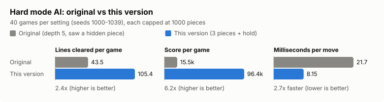
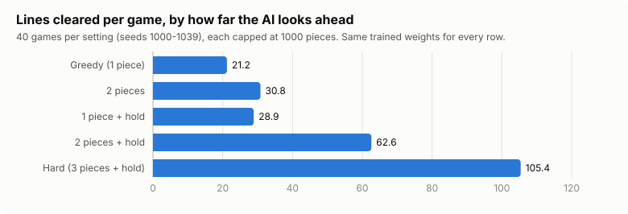
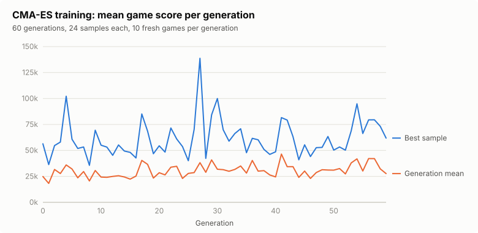

# How the ambigui2 AI works

ambigui2 is Tetris where every piece is in a superposition of two shapes. Each
piece carries two different tetrominoes (A and B) and a probability `p` that it
collapses into A. Both shapes fall side by side, and when the piece lands it
collapses: with probability `p` shape A is written to the board, otherwise B.
The player decides where the piece goes **before** knowing which shape it
becomes.

This document explains how the AI plays that game, how its weights are
trained, and how well it does.

## Why expectimax

Normal Tetris bots search a deterministic tree: pick a placement, look at the
board, repeat. Here every placement has two outcomes, so the tree naturally
alternates between two kinds of node:

```text
max node      the AI picks the best placement (optionally after using hold)
  └─ chance   the piece collapses: A with probability p, B with 1 - p
       ├─ A ─ max node (next piece) ...
       └─ B ─ max node (next piece) ...
```

That is exactly what expectimax is for. A chance node's value is the
probability-weighted average of its children:

```text
value(chance) = p * value(A) + (1 - p) * value(B)
```

This lets the AI make trade-offs a greedy bot cannot. A spot that is perfect
for shape A but makes a hole if the piece turns into B scores badly when B is
likely, and well when A is likely. The probability is part of the decision, not
noise.

Leaves are scored with a linear heuristic over six board features: aggregate
height, holes, bumpiness, wells, row transitions and column transitions (see
[`eval.zig`](../src/engine/eval.zig)). A small bonus is added for lines cleared
by the last placement. Losing scores −10⁹.

## What the search is allowed to know

`SearchOptions.depth` is the number of pieces placed along a line of play. The
player can see three pieces: the current one, the next-piece preview, and the
hold slot. The search never places anything else.

The engine is deterministic: the game state includes its RNG, so cloning a
state also clones the future piece sequence. The old search took advantage of
that. At its highest setting (Hard, old depth 5) it placed a third piece that
had not been revealed yet, read straight from the cloned RNG. Every piece now
has a serial number, and the search refuses to place a piece whose serial is
past the preview at the root (`Context.horizon` in
[`expectimax.zig`](../src/ai/expectimax.zig)). There is a test that checks a
deeper search with hold disabled plays exactly the same moves as a 2-piece
search.

## Making it fast

| Technique | What it does |
|---|---|
| Beam pruning | At each max node every placement gets a cheap 1-ply estimate, and only the best `beam_width` are searched deeper. |
| Reusing beam branches | The estimate already simulates both collapses of a placement. Those states are kept for the winners instead of being simulated again. |
| Transposition table | Different placements often produce the same position. For example, two moves that differ only in where B lands share the same A branch. Max node values are cached per search under a hash of the board, pieces, hold slot and RNG. |
| Bitwise features | The six board features are computed a whole row at a time with popcounts instead of a per-cell loop. A test checks the result against the original cell-by-cell version on 2000 random boards. |
| Resumable root | `Search.step` evaluates a few root candidates at a time. The browser build has no threads, so it runs about 6ms of search per frame instead of freezing. |

Before the behaviour changes below were made, the restructured search was
checked against the original. With hold disabled and the old physics restored,
it made exactly the same moves on every seed tested.

## Hold

Hold was implemented in the engine, but the AI never used it. Now each max node
also considers the placements of the piece that comes out of hold (or of the
next piece, if the hold slot is empty). This was the biggest single improvement
in strength. With hold, the AI chooses between two different superpositions
every turn, which is often the difference between "both outcomes are fine" and
"one outcome is a disaster".

## Results

Measured with `zig build bench -- --games 40 --moves 1000`: seeds 1000–1039,
each game capped at 1000 pieces, using the shipped `data/weights.json`.
"Old" rows were measured with the code before this rework, on the same seeds
and the same cap. The data is in [benchmark.csv](benchmark.csv).





| Search | Mean lines | Mean score | ms / move |
|---|---:|---:|---:|
| Old greedy (old depth 1) | 21.2 | 4,150 | 0.07 |
| Old 2 pieces (old depth 3, training setting) | 30.9 | 8,175 | 1.21 |
| Old Hard (old depth 5, peeks at a hidden piece) | 43.5 | 15,485 | 21.73 |
| Greedy, 1 piece | 21.2 | 4,158 | 0.03 |
| 2 pieces | 30.8 | 8,148 | 0.64 |
| 1 piece + hold | 28.9 | 7,150 | 0.07 |
| 2 pieces + hold | 62.6 | 35,803 | 1.11 |
| **3 pieces + hold (new Hard)** | **105.4** | **96,375** | **8.15** |

The new Hard AI clears about 2.4× as many lines as the old one, scores about
6× as much, and needs less than half the time per move. It also no longer
looks at pieces the player cannot see.

## Training the weights

The six heuristic weights are learned by self-play (`zig build train`). There
are two trainers:

- **Genetic algorithm** ([`genetic.zig`](../src/ai/genetic.zig)). Tournament
  selection, uniform crossover, mutation and elitism. This is the original
  trainer.
- **CMA-ES** ([`cmaes.zig`](../src/ai/cmaes.zig), `zig build train -- --cmaes`).
  Learns a multivariate normal distribution over the weights. The mean moves
  towards the best samples, and the covariance learns which directions and
  weight correlations improve fitness. With only 6 continuous parameters it
  needs far fewer games than the GA.

Both share [`training.zig`](../src/ai/training.zig):

- **Common random numbers.** Every candidate in a generation plays the same
  seeds, so differences come from the weights and not from luckier piece
  sequences.
- **Fitness is the mean score**, not lines. Strong agents survive until the
  move cap, and at that point only score still separates agents that clear
  four lines at once from agents that clear one at a time.
- **Validation on held-out seeds.** The trainer returns the best of the recent
  generation winners measured on 40 fixed games that were never used in
  training. The old trainer returned the best fitness ever seen, which mostly
  picks the luckiest generation. The run below shows why that matters:
  generation 4's winner scored 102k on its own 10 games, but no finalist reached
  51k on the held-out games.



A 60-generation CMA-ES run (24 samples per generation, 10 games each, 2-piece
search with hold) took about 7 minutes on 12 threads. The log is in
[`cmaes_history.csv`](cmaes_history.csv) and the result in
[`cmaes_weights.json`](cmaes_weights.json). On the benchmark seeds it beat the
shipped weights in Hard (114.8 vs 105.4 mean lines, 120k vs 96k mean score). It
tied in the 2-piece + hold setting it was trained in, and was worse in greedy
play. That is promising but not conclusive at 40 games, so the shipped weights
are unchanged. To try it:

```bash
zig build bench -- --weights docs/cmaes_weights.json --games 40 --moves 1000
```

## Limitations and next steps

- The search stops at the preview: three placements at most. Going further
  would mean averaging over unknown pieces (a chance node over the 7-bag),
  which is much more expensive.
- The features are generic Tetris features. Dual-state-specific features, such
  as how far apart the A and B landing spots are, are already accounted for by
  the chance nodes. But features about the I-piece wall overhang penalty might
  still help.
- Training is noisy at 10 games per candidate. More games, or re-evaluating the
  top samples, would make the weights more reliable.
