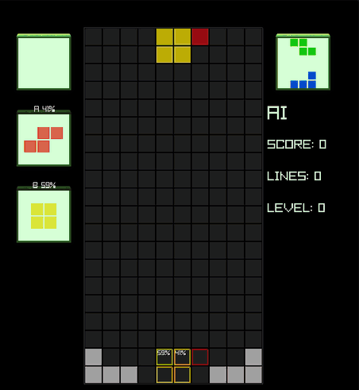
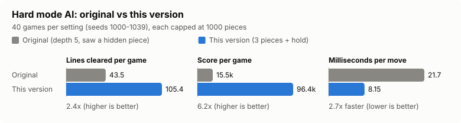
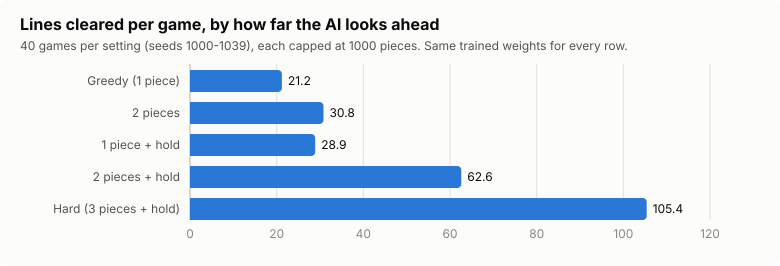
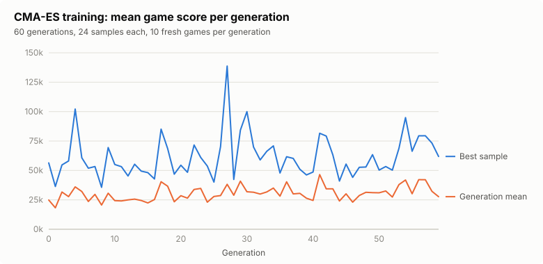
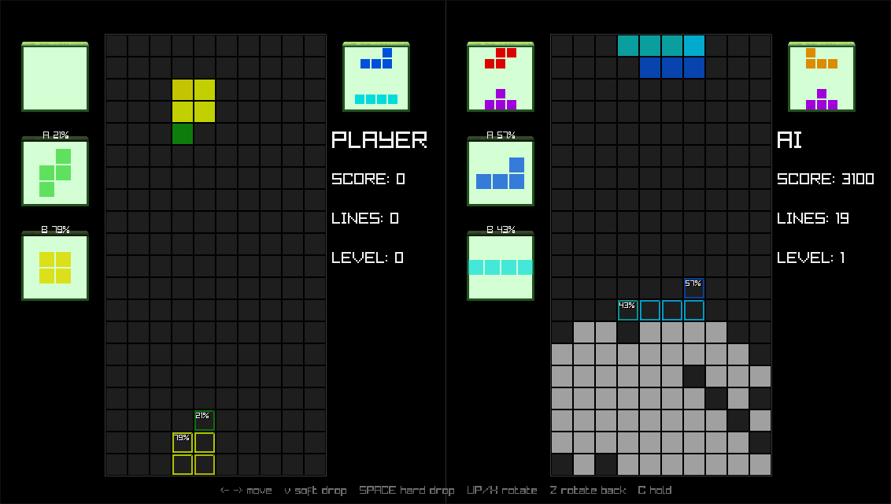

# ambigui2

[](https://github.com/Xuinnz/ambigui2/actions/workflows/ci.yml)

Tetris in superposition, with an expectimax AI opponent that learns its own
evaluation through self-play. Written from scratch in Zig, and runs on the
desktop, in a terminal, and in the browser through WebAssembly.

<p align="center">
  
  <br>
  <sub>The Hard AI playing in the browser build, slowed to 4 moves per second for the recording.</sub>
</p>

Every piece is two tetrominoes at once. Both shapes fall side by side, each
with a probability. When the piece lands it collapses into one of them. The
player, or the AI, has to choose where the piece goes **before** knowing what
it becomes.

## Highlights

- **An AI built for uncertainty.** Expectimax search alternates between the
  AI's choices and the piece's collapse. Each placement is valued by what
  happens in both possible outcomes, weighted by their probability.
- **2.4× stronger, 2.7× faster.** The reworked Hard AI clears 105 lines per
  game on average against 43.5 before, at 8.2 ms per move against 21.7.
  Measured on the same 40 games, capped at 1000 pieces. It also stopped
  reading a piece the player can't see.
- **Weights learned by self-play.** A genetic algorithm and a from-scratch
  CMA-ES (including its eigen-decomposition) train the evaluation function on
  all CPU cores, with held-out validation to avoid picking lucky runs.
- **Fast engine.** The board is a bitboard (one `u16` per row). A collision
  check takes 3.8 ns, a line clear 16 ns, and computing all six board features
  51 ns. The search visits about 2 million positions per second on one core.
- **One codebase, three platforms.** Desktop (raylib), terminal, and browser.
  The browser has no threads, so the AI runs as a resumable search that thinks
  for about 6 ms per frame and keeps the game at 60 fps. The whole web build is
  about 0.5 MB.
- **Tested and verified.** 43 unit tests and CI on every push. Performance
  refactors were checked against recorded moves from the old code: identical
  moves on every seed before any behaviour change was made.

## Results

### Before and after

The original Hard mode searched 3 pieces deep without hold, and its third piece
was read from the hidden random number generator. The new Hard mode searches 3
pieces with hold, and only uses pieces a human player can also see.



### What makes it stronger

Looking ahead helps, but searching the hold slot is what really pays off. With
hold, the AI chooses between two different superpositions every turn, and can
often find a spot where both outcomes are safe.



| Search | Mean lines | Mean score | ms / move |
|---|---:|---:|---:|
| Original greedy (old depth 1) | 21.2 | 4,150 | 0.07 |
| Original 2 pieces (old depth 3) | 30.9 | 8,175 | 1.21 |
| Original Hard (old depth 5) | 43.5 | 15,485 | 21.73 |
| Greedy, 1 piece | 21.2 | 4,158 | 0.03 |
| 2 pieces | 30.8 | 8,148 | 0.64 |
| 1 piece + hold | 28.9 | 7,150 | 0.07 |
| 2 pieces + hold | 62.6 | 35,803 | 1.11 |
| **Hard: 3 pieces + hold** | **105.4** | **96,375** | **8.15** |

<sub>40 games per row (seeds 1000–1039), capped at 1000 pieces, same trained weights.
Reproduce with `zig build bench -- --games 40 --moves 1000`. Raw data:
[docs/benchmark.csv](docs/benchmark.csv).</sub>

### Training the evaluation function

The AI scores boards with six weighted features: height, holes, bumpiness,
wells, and row and column transitions. The weights are learned by playing
thousands of games against itself.



A 60-generation CMA-ES run took about 7 minutes on 12 threads. The plot shows
why validation matters. Generation 27's best sample scored 139k on its 10
training games, but no finalist reached 51k on 40 held-out games. The original
trainer kept the best score it had ever seen, which mostly rewards luck. The new
trainer picks its final weights on games it never trained on.

Against the shipped weights, the CMA-ES weights did better in Hard (114.8 vs
105.4 mean lines) and tied in the setting they were trained in, so the shipped
weights are unchanged for now. The full write-up is in [docs/ai.md](docs/ai.md).

## How the AI works

```text
max node      the AI picks a placement (or swaps with hold first)
  └─ chance   the piece collapses: shape A with probability p, B with 1 - p
       ├─ A ─ max node for the next piece ...
       └─ B ─ max node for the next piece ...

value(chance) = p * value(A) + (1 - p) * value(B)
```

- **Beam pruning.** Every placement gets a cheap one-move estimate, and only the
  best few are searched deeper. Their simulated outcomes are kept, not recomputed.
- **Transposition table.** Different placements often lead to the same position.
  Their values are cached under a hash of the board, pieces, hold slot and RNG.
- **Knowledge horizon.** Every piece carries a serial number. The search refuses
  to place anything past the next-piece preview, so it can't use information a
  player doesn't have.
- **Resumable root.** `Search.step` evaluates a few candidates at a time. This
  lets the single-threaded browser build spread one search over several frames.
- **Training.** Every candidate in a generation plays the same seeds, so
  differences come from the weights, not from luckier piece sequences. Fitness
  is mean score, and the winner is chosen on held-out games.

## Rules

- Each piece is a pair of different shapes, A and B, with a collapse
  probability between 10% and 90%. Shapes come from a 7-bag, so every shape
  appears equally often.
- The two shapes move and rotate together but fall independently. If one lands
  first, it waits while the other keeps falling.
- When both have landed, the piece collapses: A with its probability, otherwise
  B. Only the chosen shape is written to the board.
- An I piece may hang over a wall. If it collapses there, the overhanging cells
  are lost and you get a garbage line.
- Standard scoring (100 / 300 / 500 / 800 × level). The level goes up every 10
  lines, and gravity speeds up with it.



## Play

You need [Zig 0.15.2](https://ziglang.org/download/). On Linux, the desktop
build also needs:

```bash
sudo apt install libwayland-dev wayland-protocols libxkbcommon-dev libegl1-mesa-dev
```

Desktop (solo, or player vs AI on Easy, Medium or Hard):

```bash
zig build run
```

Terminal version (press `P` to let the AI play):

```bash
zig build demo
```

| Key | Action |
|---|---|
| ← → | Move (hold to auto-repeat) |
| ↓ | Soft drop |
| Space | Hard drop |
| ↑ or X | Rotate clockwise |
| Z or Left Ctrl | Rotate counter-clockwise |
| C or Left Shift | Hold |
| R | Back to menu after game over |

| Difficulty | Opponent |
|---|---|
| Easy | No board evaluation; only goes for immediate line clears. One move per second. |
| Medium | Trained weights, 1-piece search, a move every 0.5 s. |
| Hard | Trained weights, 3-piece search with hold, as fast as it can think. |

### Browser build

It needs [emsdk](https://emscripten.org/docs/getting_started/downloads.html)
and raylib compiled for the web in `libs/wasm/` (`libraylib.a` plus
`include/raylib.h`). Build raylib from its `src/` directory with
`make PLATFORM=PLATFORM_WEB` inside an emsdk shell, and copy the resulting
`libraylib.web.a` to `libs/wasm/libraylib.a`. Then:

```bash
zig build web -Demcc=$HOME/emsdk/upstream/emscripten/emcc
```

```bash
python3 -m http.server -d zig-out/web 8000
```

Then open <http://localhost:8000>.

### Training and benchmarking

```bash
zig build train
```

```bash
zig build train -- --cmaes
```

```bash
zig build bench -- --weights path/to/weights.json --games 40 --moves 1000
```

The first command runs the genetic algorithm, and `--cmaes` uses CMA-ES instead.
Training writes `data/weights.json` (choose another path with `--out`) and a
per-generation log, `data/training_history.csv`. The weights are embedded into
every binary at build time. `zig build train -- --smoke` runs a quick check that
the pipeline works.

The charts in `docs/` are generated from CSV files with stdlib-only Python:

```bash
python3 tools/plot_history.py data/training_history.csv docs/training.svg
```

```bash
python3 tools/plot_benchmark.py docs/benchmark.csv docs
```

## Build steps

| Step | What it does |
|---|---|
| `zig build run` | Desktop game |
| `zig build demo` | Terminal game |
| `zig build web` | Browser build into `zig-out/web` |
| `zig build train` | Weight trainer (`-- --cmaes`, `-- --smoke`, `-- --out FILE`) |
| `zig build bench` | AI strength and speed across search settings |
| `zig build metrics` | Engine micro-benchmarks |
| `zig build test` | Unit tests |

Options: `-Dseed=N` fixes the piece sequence (the default `0` picks a new one
every game). `-Ddepth=N` (pieces, max 3) and `-Dbeam=N` set the terminal AI's
search.

## Layout

```text
src/
  engine/   bitboard, pieces, collision, SRS kicks, 7-bag, board features, game rules
  ai/       expectimax search, background worker, GA and CMA-ES trainers
  ui/       raylib renderer, app state machine and keyboard handling (desktop + web)
  renderer_main.zig   desktop entry point
  web_main.zig        browser entry point
  main.zig            terminal entry point
web/        HTML page for the browser build
tools/      chart scripts
docs/       AI write-up, benchmark and training data, charts, screenshots
```

## License

MIT, see [LICENSE](LICENSE).

## Academic context

This project was started for an Intro to Modern AI course and is maintained as
a systems and AI engineering project.
